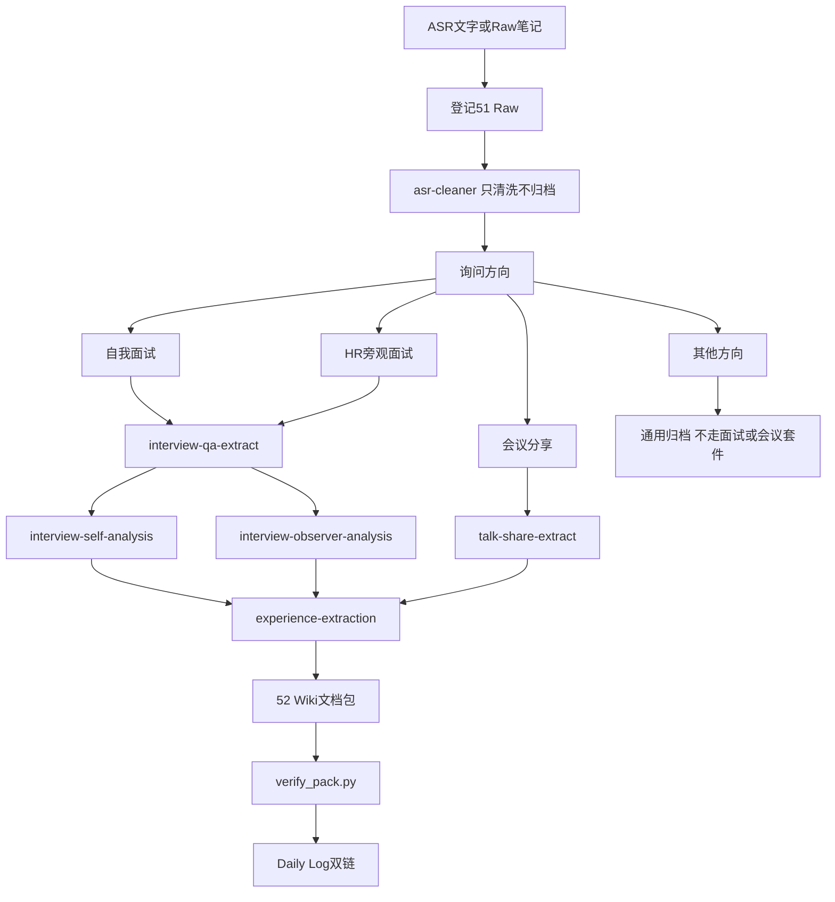

# ASR Wiki Pipeline

把已经转写好的 ASR 文字，变成 Obsidian 里可追溯的 Wiki 文档包。

这是一组互相调用的 Agent Skill，不是单个提示词。入口是 `asr-pipeline`：先登记 Raw、再忠实清洗，然后按方向分流到面试复盘或会议纪要，最后做经验萃取，并用脚本校验包是否完整。

本仓库**只处理文字**。音频、视频请先转写再进来。

## 适用场景

适合这些请求：

- 「处理这段 ASR」「把面试转写做成 Wiki」
- 「自我面试复盘」「我作为 HR 旁听的这场面试」
- 「黑客松 / 台上分享 / 大讲堂做成纪要和横向分析」
- 「从这场活动里萃取可复用经验」

不适合：

- 直接转写音频视频
- 只要一句摘要、不要原文
- 一面二面对照（用本系列的 `interview-round-compare`，但不会被主管道自动触发）

## 仓库里有什么

```text
.
├── README.md
├── LICENSE
├── install.sh
└── skills/
    ├── asr-pipeline/                 # 主调度
    ├── asr-cleaner/                  # 忠实清洗 + handoff
    ├── interview-qa-extract/         # 面试全文一问一答
    ├── interview-self-analysis/      # 自我面试复盘 / 多视角评分
    ├── interview-observer-analysis/  # HR 旁观面试分析
    ├── interview-round-compare/      # 一面 vs 二面（手动）
    ├── talk-share-extract/           # 会议全文 + 议程 + 横向分析
    └── experience-extraction/        # 经验萃取深卡
```

每个目录都是标准 Agent Skill：`SKILL.md` + `references/`，部分带 `scripts/`。

## 调用链



| 方向 | 调用顺序 | 包内产物 |
| --- | --- | --- |
| 自我面试 | `interview-qa-extract` → `interview-self-analysis` → `experience-extraction` | 01 一问一答、02 逐题评分、03 多视角评估、04 经验萃取 |
| HR 旁观 | `interview-qa-extract` → `interview-observer-analysis` → `experience-extraction` | 01 一问一答、02 面试官分析、03 经验萃取 |
| 会议分享 | `talk-share-extract` → `experience-extraction` | 01 一问一答或全文转写、02 议程、03 纪要、04 现场问答索引、05 横向分析、06 经验萃取 |
| 其他 | 不跑本系列分析套件 | 按通用知识编译处理 |

`interview-round-compare` 只在用户明确要求对照两轮面试时使用。

会议方向下，`talk-share-extract` 写出的 `01` 路径必须回填到 `pipeline.json` 的 `qa_path`。`experience-extraction` 从该字段读原文，不从纪要读。

## 每个 Skill 做什么

| Skill | 职责 | 不做什么 |
| --- | --- | --- |
| `asr-pipeline` | 登记 Raw、编排清洗、询问方向、建 Wiki 包、写 Daily Log、跑校验 | 不自己写分析正文 |
| `asr-cleaner` | 忠实清洗、清洗报告、handoff manifest | 不语义压缩、不归档生活日志 |
| `interview-qa-extract` | 把清洗稿切成完整一问一答 | 不评分、不概括 |
| `interview-self-analysis` | 自我复盘、加权评分、SSC / BP / COE 多视角 | 不代替原文 |
| `interview-observer-analysis` | 从 HR 旁观看面试官与候选人 | 不编造未出现的岗位信息 |
| `interview-round-compare` | 对照同一岗位两轮面试官口径 | 不自动触发 |
| `talk-share-extract` | 会议全文、议程、纪要、问答索引、横向分析 | 不评分、不做面试画像 |
| `experience-extraction` | 从 01 原文出可复用深卡，并补外部信源 | 不从摘要脑补原话 |

在管道里调用 `asr-cleaner` 时必须 `--no-archive`，不要调用 `asr-life-log`。单独清洗生活录音时，才走 cleaner 的默认归档路径。

## 01 必须是原文

面试和会议的 `01` 都是清洗稿的完整重排，不是纪要。

三条同时满足才算通过。字数比大于 100% 是重复信号，不是通过信号：

1. 句级覆盖：清洗稿正文每个不少于 12 字的句子，至少 90% 能在 01 里找到
2. 无重复：同一题的「问题原文」和「回答原文」不得含相同段落；全文引用重复率不超过 5%
3. 无占位：不得残留 `〔…〕`、`TODO`、`待补`

会议有问答就出 `01 …｜一问一答.md`，切不出问答对就出 `01 …｜全文转写.md`，两份不要并存。

## 命名与落盘

包内文件一律 `NN <活动名>｜<文件角色>.md`。序号保证包内排序，活动名前缀保证跨包双链不撞名。

文档地图**不加序号**，文件名是 `<活动名>｜文档地图.md`。

默认 Wiki 父目录（领域已定时）：

| domain | 目录 |
| --- | --- |
| HR | `52 编译产物（Wiki）/52.01 人力资源（HR）/52.01.05 语音转录总结` |
| AI | `52 编译产物（Wiki）/52.02 人工智能（AI）/52.02.06 语音转录总结` |

Raw 默认进 `51.08 ASR（Raw）`：待清洗进 `ASR-待清洗`，交接完成后移到 `ASR-清洗完成`。禁止把清洗稿覆盖进 Raw 正文。

Vault 笔记读写用 `obsidian` CLI，不要用通用文件工具直写。临时产物放 `/tmp/asr-life-log/<pipeline-id>/` 和 `/tmp/asr-interview/<pipeline-id>/`。

## 安装

需要：Python 3.10+、已安装并登录的 [Obsidian CLI](https://help.obsidian.md/cli)、Agent 运行时的 skills 目录。

```bash
git clone https://github.com/CamellionKid/asr-wiki-pipeline.git
cd asr-wiki-pipeline
chmod +x install.sh
./install.sh
```

`install.sh` 会把 8 个 skill 软链到本机已存在的目录：

- `~/.agents/skills`
- `~/.claude/skills`
- `~/.cursor/skills`
- `~/.codex/skills`
- `~/.gemini/config/skills`
- `~/.gemini/skills`
- `~/.config/opencode/skills`

目录不存在就跳过，不会新建。只装某一个 skill 时，把 `skills/<name>` 拷进对应 skills 目录即可，保持内部结构不变。

装好后对 Agent 说「处理这段 ASR」或「把这场分享做成 Wiki」，应加载 `asr-pipeline`。

## 校验

写完 Wiki 包必须跑：

```bash
python3 skills/asr-pipeline/scripts/verify_pack.py \
  --pack-dir "<Wiki包目录>" \
  --cleaned "<cleaned-transcript.md>"
```

七项全 PASS 才算完成，有 FAIL 非零退出：

1. 序号 `01..N` 连续；文档地图无数字前缀且带活动名
2. `01` 角色是「一问一答」或「全文转写」，`transcript_mode` 与文件名一致
3. 句级覆盖率不低于 90%
4. 引用重复率不超过 5%；同题问答不得逐字相同
5. 无占位符
6. 文档地图里的包内双链都能解析
7. YAML 必需字段齐全

cleaner 的 handoff 契约可单独测：

```bash
python3 -m unittest skills/asr-cleaner/tests/test_handoff_contract.py
```

## 敏感数据

旁观面试默认按含候选人个人数据处理。未获「确认归档」前：分析可以做，Wiki 里对姓名和可识别前雇主做最小化。自我面试按本人材料处理。不要把候选人原文提交到公共仓库。

## 本系列之外的依赖

主管道在「其他方向」或落盘归档时，可能再调用这些已有 skill，它们**不在本仓库**：

- `obsidian-cli`：Vault 读写
- `file-classification-johnny-decimal` / `darren-archive`：归档路由
- `knowledge-compiler`：非面试、非会议的通用编译
- `asr-life-log`：生活录音归档；本管道默认不调用

历史包例外见 `skills/asr-pipeline/references/storage-rules.md`：苏州科达短文件名、HRMax 黑客松缺 01 全文层，都保持原样，除非你明确要求补。

## 维护说明

如果你同时维护 `~/ai-skills/shared-skills`，那边是本机全量 skill 的工作副本。本仓库是 ASR 这一条产品线的可安装发行版。改规则时先改对应 `SKILL.md` / `references/`，再同步到另一边。

## License

MIT. See [LICENSE](LICENSE).
